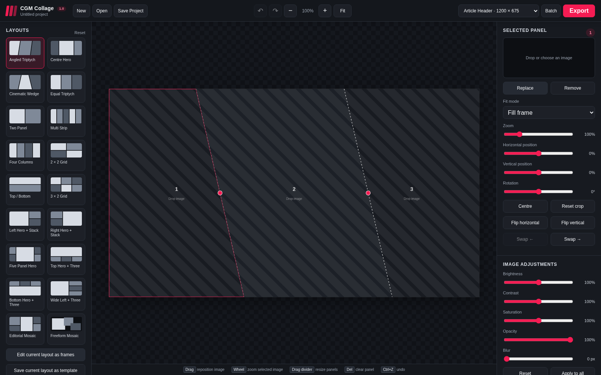

# CGM Collage

CGM Collage is a native Windows editor for building editorial headers, feature images, roundups, rankings, and social artwork from reusable multi-panel layouts.



## Highlights

- Native WPF desktop interface with a responsive SkiaSharp canvas
- 18 built-in editorial layouts plus flexible Auto Grid, Columns, and Rows layouts
- Choose 1-64 image panels, add or delete panels, and import batches that grow the layout automatically
- Drag an image onto another panel to swap their images and edits; drag onto an empty panel to move it
- Drag the selected frame's sides or corners to resize it beyond the preset layouts
- Drag-and-drop image placement, panel selection, pan, zoom, rotate, flip, fill, and fit
- Brightness, contrast, saturation, opacity, borders, and shadows
- JPEG, PNG, and WebP export at common editorial and social sizes
- Undo/redo, autosave recovery, embedded images, and `.cgmcollage` project files
- Native, self-contained Windows installers for x64 and ARM64; no separate .NET or browser runtime required

## Arrange a collage

Set **Collage images** to a number from 1 to 64 and click **Apply** (or press Enter). Auto Grid fills the canvas at every count, including uneven rows. Columns and Rows also adapt to the current count. The original editorial presets keep their designed panel counts.

Use **Add images.** to import several files at once. Existing images stay in place and extra files create more panels. Drop files onto a particular panel to replace its image, then fill empty panels and expand as needed. Imports that would exceed 64 panels are rejected without changing the collage. Reducing the count or applying a smaller preset asks before removing occupied panels.

Drag an image between panels to swap placement. Crop, zoom, rotation, flips, fit mode, opacity, and colour adjustments travel with the image; panel shape and borders stay in place. Hold **Shift** while starting a drag, or enable **Pan image**, to adjust the crop. Double-click a panel to choose an image. **+ Add panel**, **Duplicate panel**, and **Delete panel** provide quick layout changes. All these edits support undo and redo.

Select a frame, then drag its sides or corner handles to change its size. This also works on empty panels. Angled panels keep their shape as they resize. Resizing adjusts that frame independently, so custom arrangements can include gaps or overlaps. The layout becomes **Custom**; changing the image count or applying a layout arranges the panels again. Press **Escape** during a resize to cancel it, or undo after releasing the mouse.

## Install the application

Download `CGM-Collage-Setup-x64.exe` for Intel/AMD computers or `CGM-Collage-Setup-arm64.exe` for ARM-based Windows computers from the latest GitHub release. Installation is per user and does not require administrator access.

## Build

Install the .NET 10 SDK and Inno Setup, then run:

```powershell
./build.ps1 -RuntimeIdentifier win-x64
./build.ps1 -RuntimeIdentifier win-arm64
```

The self-contained applications and architecture-specific installers are written to `artifacts/`.

## Keyboard and mouse

- Drop image files on the canvas to fill panels
- Drag an image between panels to swap placement
- Drag the selected frame's sides or corners to resize it; Escape cancels a resize
- Shift+drag, or enable Pan image, to reposition its crop
- Use the mouse wheel over the canvas to zoom the selected image
- `Delete` or `Backspace` clears the selected panel
- `Ctrl+S` saves the project
- `Ctrl+Z` / `Ctrl+Y` undo and redo

## Privacy

Images and project data remain on the computer. The application has no telemetry or cloud processing.

## License

MIT
